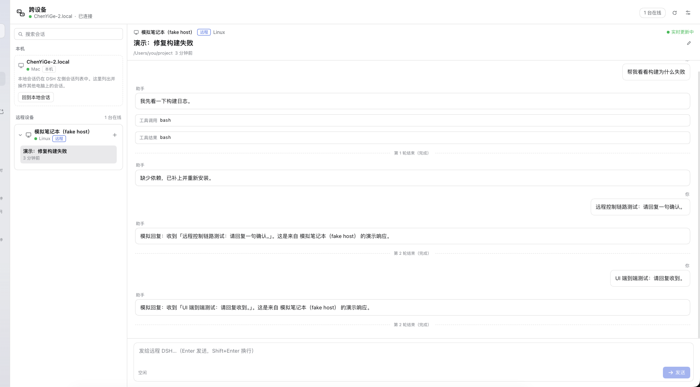
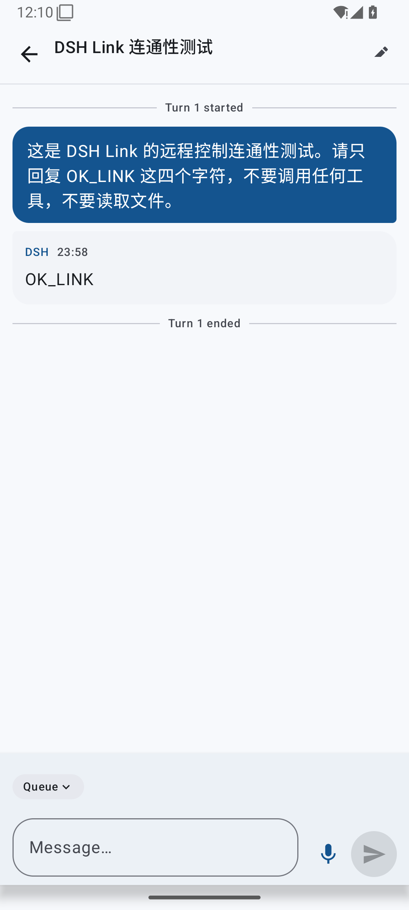

# DSH Link

> Connect DeepSeek Harness (DSH) installs on several computers and an Android phone through your own relay server: one private space for your own devices. Browse and drive another computer's DSH Sessions from this one, and use voice input on the phone with recognizers that stay on the target computer.

[](LICENSE)

[中文](README.md) | **English**




## What it does

- **Multi-computer link**: install the same DSH plugin on each computer and paste one pairing code. Traffic goes through your own relay over the public internet; no public IP, port forwarding, NAT traversal, or VPN is required on the computers.
- **Browser-style workspace tabs**: the DSH **Workspaces** area becomes a tab bar — the first tab is **This computer**, and every online computer gets its own tab with that computer's project/Session tree. Each tab supports search, archive, rename, new Session, and remote model/reasoning/plugin-preset settings.
- **Native remote conversation**: remote messages, tool calls/results and turn state render in the normal chat. Typing into the native composer forwards the prompt to the remote DSH and streams its reply back; the local model is gated off.
- **The local agent can drive another computer**: `link_sessions` / `link_read` / `link_prompt` / `link_create` / `link_cancel` tools let the AI on computer A operate DSH on computer B.
- **Android app**: one app connects to multiple computers, browses and drives Sessions, supports dark/light themes and **foldables** (e.g. Huawei Mate X7) with a hinge-aware two-pane layout.
- **Voice input round-trip**: record on the phone → send to the selected computer → its local SenseVoice recognizer → **text returns to the phone's editable input box**. Audio is never sent to a cloud recognizer.
- **No exposed DSH ports**: both computers and the phone dial out to the relay; the relay forwards without storing conversation content.

## Architecture

```
┌──────────────────────┐        ┌──────────────────────┐
│ Computer A · DSH     │        │ Computer B · DSH     │
│  DSH Link plugin     │        │  DSH Link plugin     │
└──────────┬───────────┘        └──────────┬───────────┘
           │ WSS (outbound; no public IP)   │ WSS
           ▼                               ▼
      ┌─────────────────────────────────────────┐
      │ Your server · relay (TLS 8443)          │
      │ device directory + call/stream routing  │
      └────────────────────▲────────────────────┘
                           │ WSS
                    ┌──────┴───────┐
                    │ Android app  │
                    │ devices+voice│
                    └──────────────┘
```

- **Plugin Host half** (`plugin/index.js`): pairing, relay client, remote Session RPC, local DSH adapters, speech recognition, agent tools, same-origin HTTP API.
- **Plugin Web UI half** (`plugin/client.js`): replaces the sidebar Workspaces region with per-computer tabs, loads local/remote project trees, and keeps remote Sessions opening in the native DSH conversation with the device chip and remote settings entry.
- **Session mirror** (`plugin/index.js`): creates a `[Remote] <device>` workspace, mirrors the 10 most recent Sessions, subscribes to `session.follow` while a mirror is open, appends remote records as native DSH events, and rejects local model steps for mirror Sessions while forwarding the prompt to the remote Host.
- **Relay** (`relay/`): public TLS WebSocket; device directory and forwarding only, no business data stored.
- **Android** (`android/`): Kotlin + Jetpack Compose; multi-device Sessions, voice recording round-trip, foldable layout.
- **Protocol**: `protocol/PROTOCOL.md` is the single contract shared by Host, Web UI, app and relay.

## Repository layout

```
dsh-link/
├── plugin/      DSH bundle (Host + Web UI + locales + icon)
├── relay/       relay server, deploy script, systemd unit, protocol tests
├── android/     Android app (Kotlin + Compose + foldables)
├── protocol/    v1 protocol specification
├── tools/       probe-client / fake-host development helpers
└── docs/        architecture, install, FAQ, screenshots
```

## Quick start

### 0. Prerequisites

- A Linux server with a public IP (Ubuntu 22.04 works; 1 vCPU / 1 GB is enough; port 80 available for ACME).
- One or more computers with **DSH Desktop 0.2.x**.
- Android 7.0+ phone (Huawei Mate X7 and other HarmonyOS devices can install Android APKs).

### 1. Deploy the relay (once, on the server)

The relay listens on **8443/TLS** and uses a Let's Encrypt certificate. If you do not own a domain, [sslip.io](https://sslip.io) maps `<server-ip>.sslip.io` to your IP, which is enough for a certificate.

```bash
# on the server
apt-get update && apt-get install -y certbot
certbot certonly --standalone -d <SERVER_IP>.sslip.io --agree-tos -m you@example.com
git clone https://github.com/yuyeyubee/dsh-link.git /opt/dsh-link-src
cd /opt/dsh-link-src/relay
sudo ./deploy.sh        # installs deps, generates token/pairing code, installs systemd unit
# custom domain: sudo DSHLINK_DOMAIN=relay.example.com ./deploy.sh
```

After it completes:

- service: `systemctl status dsh-link-relay`
- authoritative pairing code: `/opt/dsh-link/pairing.txt` (0600; contains the token — keep it private)
- public endpoint: `wss://<SERVER_IP>.sslip.io:8443/`

See [relay/README.md](relay/README.md) for renewal, token rotation, ports and firewall notes.

### 2. Install the plugin on each computer

```bash
git clone https://github.com/yuyeyubee/dsh-link.git
```

Install the local bundle in DSH: ask the agent to call `plugin_manager` `install_bundle` with the absolute path of `dsh-link/plugin`, or use the Plugins settings page to install a local bundle.

After installation, refresh the DSH page (the desktop app usually applies it through HMR):

- a **Link** entry appears in the left sidebar;
- **Settings → Link** shows the pairing page.

### 3. Pair

1. Open **Settings → Link**.
2. Paste the whole `dshlink1.…` string from `/opt/dsh-link/pairing.txt` into the pairing field.
3. Leave the device name empty to use the computer name.
4. Click **Save pairing code**.

The page then shows **Connected** and the other online computers. Repeat on every computer.

> The same pairing code is used by the phone. It contains the space token; treat it like a password.
>
> The plugin also supports **automatic import**: on first start, if `~/.dsh/dsh-link/pairing.txt` exists, it is imported and then deleted (the token moves to the DSH credential store). This helps batch or remote setup.

### 4. Install the Android app

Download `dsh-link-android-*.apk` from [Releases](https://github.com/yuyeyubee/dsh-link/releases/latest) and install it on the phone (allow installing from unknown sources).



In the app:

1. paste the **same** `dshlink1.…` pairing code;
2. pick an online computer at the top;
3. browse Sessions, send prompts, stop a running turn;
4. tap the microphone, record, stop; the selected computer transcribes and the text returns to the editable input box — review, edit, then send.

### 5. Switch computers in the DSH workspace

After pairing, the **Workspaces** area in the DSH sidebar becomes a browser-style tab bar:

```
┌ This computer ┬ MacBook at home ┬ Travel laptop ┐
│ local projects / Sessions                      │
└────────────────────────────────────────────────┘
```

- **This computer** shows local projects and Sessions; each online computer has its own tab with its own project/Session tree, titles, paths and running state.
- Search filters the active tab only; **Show archived**, refresh, **+** new Session, and project/Session **rename** / **archive** act on the active tab.
- Clicking a remote Session creates its mirror on demand and opens the **native DSH conversation**: the device chip shows `Remote · <device>`, remote messages/tool results/turn state render natively, and replies stream back.
- Prompts typed in the native composer are forwarded to that computer; the local model is gated off. The remote-settings gear in the conversation header changes the remote **model, reasoning effort and plugin/Agent preset**.
- New remote Sessions appear within about 60 seconds; opening a tab or Session refreshes immediately.
- The **Cross-device** entry remains for pairing, device management, Android pairing and voice status. Disable the plugin to restore DSH's built-in Workspaces list.


### 6. Let the agent drive another computer

Just ask in any DSH conversation, e.g. "what Sessions are on the laptop?" or "ask the home computer to continue the tests". The agent uses:

| Tool | Purpose |
| --- | --- |
| `link_status` | pairing/connection state and online devices |
| `link_devices` | list other online computers |
| `link_sessions` | list Sessions on a computer |
| `link_read` | read the latest messages of a remote Session |
| `link_create` | create a Session on a remote computer |
| `link_prompt` | send a prompt and wait for the reply |
| `link_cancel` | stop the current turn of a remote Session |
| `link_debug` | diagnostics (Session list, title projections, speech providers, config) |

## Voice pipeline

```
phone recording (16 kHz mono PCM16) → standard WAV → base64
      → relay → target computer's DSH Link → local speechToText / SenseVoice
      → text → relay → phone input box (editable; never auto-sent)
```

- Recognition always runs on the **target computer**; the phone does not download a model and audio is not sent to a cloud recognizer.
- Only canonical 44-byte-header WAV is accepted (`data` immediately after `fmt `); the app ships a generator.
- The first recognition loads the local model and may take a few seconds; pre-warm it in DSH Settings if desired.

## Foldables

- Width ≥ 720dp: two panes (devices + Sessions on the left, conversation on the right); narrow: one pane with back.
- `WindowInfoTracker` `FoldingFeature`: vertical hinge → side-by-side, horizontal hinge → stacked, with a gap that keeps content off the hinge.
- Folding/unfolding/rotation preserves the selected device, Session and draft (ViewModel + rememberSaveable).

## Security

- Only the relay's 8443/TLS is public; computers and phones connect outbound.
- One space token grants everything. Rotate it and re-pair all devices if it leaks (see relay README).
- The desktop token is stored in the DSH credential store (`dsh-link/token`) with a 0600 config; the phone keeps it in app-private storage; the relay logs no params/results.
- Built for personal use: no multi-tenancy, roles, audit, or sharing.

## Known limitations

- No offline queue: a remote call fails immediately when the target computer is offline.
- Remote Sessions are **mirrors**: only the 10 most recent non-subagent Sessions per computer are synced; deleting a remote Session does not remove its local mirror automatically.
- Remote tool calls/results appear as text cards in the mirror; attachments, approval prompts and model switching still happen on the target computer.
- Native composer sends use a mirror gate: the local turn ends without a model request and the remote reply is appended afterwards. Avoid sending the next prompt before the previous reply arrives.
- A cold/closed mirror is refreshed when opened; the Host pushes live updates only while the mirror conversation is open.
- Long tool results and text are truncated to keep relay/mobile frames bounded; read the full content on the target computer.
- The APK is a self-signed debug build; installing requires allowing unknown sources. Configure release signing for distribution.
- Protocol v1 makes no cross-version compatibility promise; keep plugin, relay and app on the same version.

## Development

```bash
# plugin host tests (plain Node)
cd plugin && node --test test/

# relay protocol suite against the public WSS endpoint
cd relay && npm install && node test-client.mjs
cd relay && node test-client.mjs --slow

# Android
cd android && ./gradlew :app:assembleDebug
cd android && ./gradlew :app:testDebugUnitTest

# development helpers: fake remote computer / probe client
node tools/fake-host.mjs --pairing-file ~/.dsh/dsh-link/pairing-code.txt --name "Fake laptop"
node tools/probe-client.mjs --pairing-file ~/.dsh/dsh-link/pairing-code.txt --method device.info
```

See [docs/architecture.md](docs/architecture.md), [docs/install.md](docs/install.md) and [docs/faq.md](docs/faq.md).

## License

[MIT](LICENSE)
