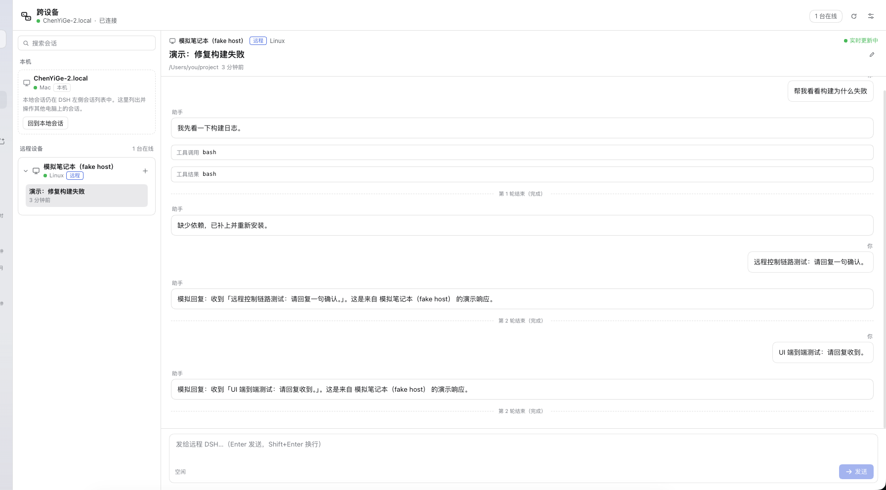

# DSH Link · 跨设备互联

> 通过你自己的公网中转服务器，把多台电脑上的 **DeepSeek Harness（DSH）** 和 **Android 手机** 连成一个只属于你的私有空间：在这台电脑上直接看到、打开、操作另一台电脑的 DSH 会话；手机也能连接多台电脑，并用语音输入把话发到指定电脑、由那台电脑本地识别后把文字传回手机。

[](LICENSE)

**中文** | [English](README.en.md)



## 能做什么

- **多台电脑互相连通**：每台电脑安装同一个 DSH 插件，填一次配对码即可；设备之间通过你自己的 relay 走公网，不需要公网 IP、内网穿透或 VPN。
- **侧边栏区分本地与远程**：DSH 左侧栏新增「跨设备」入口；主面板左侧按设备分组列出远程电脑及其会话，与本地工作区在视觉上明确分开，一键切换。
- **远程工作区**：查看远程会话的实时消息、工具调用/结果、轮次状态；直接发送/停止/新建/重命名远程会话。
- **AI 直接控制另一台电脑**：本机 DSH 的 AI 通过 `link_sessions` / `link_read` / `link_prompt` / `link_create` / `link_cancel` 工具操作远程 DSH，适合「让家里的电脑继续跑任务」「在笔记本上查看家里那台的进度」。
- **Android App**：一个 App 连接多台电脑，浏览/新建/操作会话；深/浅色；**折叠屏**（华为 Mate X7 等）展开后双栏、铰链不遮挡内容。
- **手机语音输入**：手机录音 → 发到所选电脑 → 该电脑用本机 SenseVoice 识别 → **文字回到手机输入框**，可修改后再发送；音频不经过云端识别。
- **不用 DSH 也能远程控制会话**：relay 只转发，不保存会话内容；电脑上的 DSH 端口不暴露公网。

## 架构

```
┌──────────────────────┐        ┌──────────────────────┐
│ 电脑 A · DSH Desktop │        │ 电脑 B · DSH Desktop │
│  DSH Link 插件       │        │  DSH Link 插件       │
└──────────┬───────────┘        └──────────┬───────────┘
           │ WSS（主动外连，无需公网 IP）    │ WSS
           ▼                               ▼
      ┌─────────────────────────────────────────┐
      │ 你的服务器 · relay（TLS 8443）          │
      │ 同 token 空间：设备名录 + 呼叫/流式转发 │
      └────────────────────▲────────────────────┘
                           │ WSS
                    ┌──────┴───────┐
                    │ Android App  │
                    │ 多设备 + 语音 │
                    └──────────────┘
```

- **插件 Host 半**（`plugin/index.js`）：配对、relay 连接、远程会话 RPC、本机 DSH 服务适配、语音识别、Agent 工具、同源 HTTP API。
- **插件 Web UI 半**（`plugin/client.js`）：侧边栏入口、远程工作区主面板、设置页。
- **relay**（`relay/`）：公网 TLS WebSocket 中转；只维护在线设备名录和转发，不解析/不保存业务数据。
- **Android**（`android/`）：Kotlin + Jetpack Compose，多设备会话控制、语音录制回传、折叠屏适配。
- 协议：`protocol/PROTOCOL.md`（Host / Web UI / App / relay 的唯一契约）。

## 目录

```
dsh-link/
├── plugin/      DSH 插件（Host + Web UI + 中英文元数据 + 图标）
├── relay/       relay 服务端、部署脚本、systemd unit、协议测试
├── android/     Android App（Kotlin + Compose + 折叠屏）
├── protocol/    v1 协议规范
├── tools/       probe-client / fake-host 开发测试工具
└── docs/        架构、安装、FAQ、截图
```

## 快速开始

### 0. 准备

- 一台有公网 IP 的 Linux 服务器（Ubuntu 22.04 即可，1C1G 起步；可用 80 端口申请证书）。
- 一台或多台安装了 **DSH Desktop 0.2.x** 的电脑（macOS / Windows / Linux）。
- Android 7.0+ 手机（华为 Mate X7 等鸿蒙设备可安装 Android APK）。

### 1. 部署 relay（在服务器上，只需一次）

relay 默认监听 **8443/TLS**，用 Let's Encrypt 证书。没有域名也可以：用 [sslip.io](https://sslip.io) 把 `<服务器IP>.sslip.io` 解析到你的 IP，用它申请证书。

```bash
# 服务器上
apt-get update && apt-get install -y certbot
certbot certonly --standalone -d <服务器IP>.sslip.io --agree-tos -m you@example.com
git clone https://github.com/yuyeyubee/dsh-link.git /opt/dsh-link-src
cd /opt/dsh-link-src/relay
sudo ./deploy.sh        # 安装依赖、生成 token/配对码、装 systemd 并启动
# 自有域名：sudo DSHLINK_DOMAIN=relay.example.com ./deploy.sh
```

完成后：

- 服务：`systemctl status dsh-link-relay`
- 权威配对码：`/opt/dsh-link/pairing.txt`（0600，含 token，请勿外传）
- 公网入口：`wss://<服务器IP>.sslip.io:8443/`

> 详细步骤、证书续期、轮换 token、端口/防火墙见 [relay/README.md](relay/README.md)。

### 2. 在每台电脑安装插件

```bash
git clone https://github.com/yuyeyubee/dsh-link.git
```

在 DSH 中安装本地 bundle：让 Agent 调用 `plugin_manager` 的 `install_bundle`，参数为上面的 `dsh-link/plugin` 绝对路径；或在 DSH 的插件管理页面选择本地 bundle 并指向该目录。

安装后刷新 DSH 页面（桌面版会随 HMR 自动生效）：

- 左侧栏出现 **跨设备** 入口；
- 「设置 → 跨设备」出现配对页。

### 3. 配对

1. 打开 **设置 → 跨设备**；
2. 把服务器 `/opt/dsh-link/pairing.txt` 里的整串 `dshlink1.…` 粘贴到「配对码」；
3. 设备名可留空（默认使用电脑名）；
4. 点「保存配对码」。

配对成功后，页面显示「已连接」和其他在线电脑。每台电脑重复一次。

> 本机配对码也可以复制给手机用；配对码包含 token，等同密码，不要发到公开群聊或提交到仓库。
>
> 插件支持**自动导入**：首次启动时若存在 `~/.dsh/dsh-link/pairing.txt`，会自动读取并删除该文件（token 转入 DSH 凭据存储），适合批量/远程部署。

### 4. 安装 Android App

从 [Releases](https://github.com/yuyeyubee/dsh-link/releases/latest) 下载 `dsh-link-android-*.apk`，传到手机安装（需要允许「安装未知来源应用」）。

打开 App：

1. 粘贴与电脑**同一个** `dshlink1.…` 配对码；
2. 连接后顶部会出现在线电脑列表，点选要操作的电脑；
3. 浏览会话、发送消息、停止运行中的回合；
4. 点麦克风录音 → 停止 → 等待所选电脑识别 → 文字回到输入框，确认/修改后发送。

### 5. 使用远程工作区

点击左侧栏 **跨设备**：

- 左侧「本机」卡片说明本地会话仍在 DSH 原来的工作区列表里；点「回到本地会话」可返回。
- 「远程设备」列出所有在线电脑；展开设备查看会话，点会话进入右侧对话。
- 顶部显示远程设备、会话标题、工作目录、实时更新状态；右下角输入框发送，运行中可停止。
- 窄窗口下列表与对话二选一，带返回按钮；桌面端侧边栏折叠时会自动切换。

### 6. 让 AI 操作另一台电脑

在任意 DSH 会话里直接说「看看出差笔记本上有什么会话」「让家里的电脑继续跑测试」，AI 会使用：

| 工具 | 作用 |
| --- | --- |
| `link_status` | 本机配对/连接状态、在线设备 |
| `link_devices` | 列出其他在线电脑 |
| `link_sessions` | 列出某台电脑的会话 |
| `link_read` | 读取某台电脑某个会话的最近消息 |
| `link_create` | 在某台电脑新建会话 |
| `link_prompt` | 向某台电脑的会话发消息并等待回复 |
| `link_cancel` | 停止某台电脑会话的当前回合 |
| `link_debug` | 诊断（会话列表/标题 projection/语音 provider/配置） |

## 语音链路

```
手机录音（16 kHz 单声道 PCM16）→ 手机写标准 WAV → base64
      → relay → 目标电脑 DSH Link → 本机 speechToText / SenseVoice
      → 文字 → relay → 手机输入框（可编辑，不自动发送）
```

- 识别发生在**目标电脑**，手机不下载模型、音频不上传第三方云端。
- 只接受标准 44 字节头 WAV（`fmt ` 后紧跟 `data`）；App 已内置生成器。
- 首次识别会唤醒本地模型，可能需要数秒；可在 DSH 设置里提前准备语音模型。

## 折叠屏

- 宽度 ≥ 720dp 时自动双栏：左侧设备+会话，右侧对话；窄屏单栏 + 返回。
- 使用 `WindowInfoTracker` 读取 `FoldingFeature`：纵向铰链左右分栏、横向铰链上下布局，铰链区域留白，不压住内容。
- 折叠/展开/旋转不会丢失当前设备、会话和草稿（ViewModel + rememberSaveable）。

## 安全

- 公网只暴露 relay 的 8443（TLS）；电脑和手机都主动外连，不开放入站端口。
- 一个 space token 就是全部权限；泄露后轮换 token 并重新配对（见 relay README）。
- 电脑端 token 保存在 DSH 凭据存储（`dsh-link/token`），配置 0600；手机端存应用私有目录；relay 不记录请求/响应正文。
- 这是个人自用工具，没有多租户、角色、审计或分享权限。

## 已知限制

- relay 不做离线队列：目标电脑没开 DSH 时远程调用立即失败。
- 远程工作区是只读渲染 + 发送/停止/新建/改名，不含附件上传、权限弹窗应答、模型切换等完整 DSH UI。
- 工具结果和长文本会截断（防止手机/relay 收到超大帧），完整内容需到目标电脑查看。
- APK 为自签名 debug 包，安装时需允许未知来源；上架应用商店需自行配置 release 签名。
- 协议 v1 不做跨版本兼容承诺；插件、relay、App 请使用同一版本。

## 开发与验证

```bash
# 插件 Host 半（纯 Node 测试）
cd plugin && node --test test/

# relay（本机对公网 WSS 跑协议套件）
cd relay && npm install && node test-client.mjs
cd relay && node test-client.mjs --slow

# Android
cd android && ./gradlew :app:assembleDebug
cd android && ./gradlew :app:testDebugUnitTest

# 开发用：模拟一台远程电脑 / 探针客户端
node tools/fake-host.mjs --pairing-file ~/.dsh/dsh-link/pairing-code.txt --name "模拟笔记本"
node tools/probe-client.mjs --pairing-file ~/.dsh/dsh-link/pairing-code.txt --method device.info
```

更详细的设计见 [docs/architecture.md](docs/architecture.md)、安装/排障见 [docs/install.md](docs/install.md) 与 [docs/faq.md](docs/faq.md)。

## License

[MIT](LICENSE)
